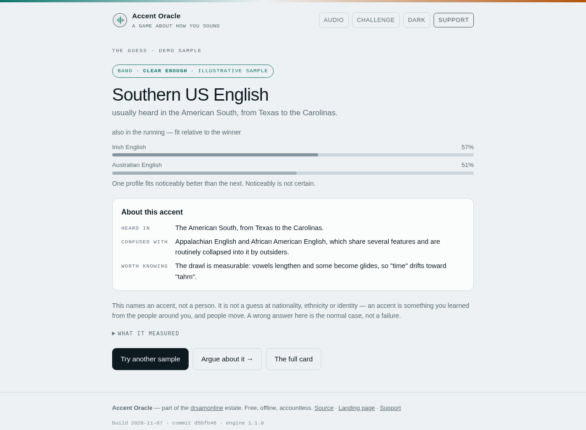

<p align="center">
  
</p>

<h1 align="center">Accent Oracle</h1>

<p align="center"><em>It listens to four seconds of speech and guesses which accent it heard —<br>on device, with a band on how sure it is.</em></p>

<p align="center">
  <a href="https://drsamonline.github.io/accent-oracle/"></a>
  <a href="https://github.com/drsamonline/accent-oracle/actions/workflows/test.yml"></a>
  <a href="https://github.com/drsamonline/accent-oracle/actions/workflows/presentation.yml"></a>
  <a href="LICENSE"></a>
</p>

<p align="center">
  
  
  
  
</p>

<p align="center">
  <a href="https://drsamonline.github.io/accent-oracle/play/"><b>Open the app →</b></a>
  &nbsp;·&nbsp;
  <a href="https://drsamonline.github.io/accent-oracle/">Landing page</a>
  &nbsp;·&nbsp;
  <a href="USER-GUIDE.md">User guide</a>
  &nbsp;·&nbsp;
  <a href="ACCENTS.md">The twelve</a>
  &nbsp;·&nbsp;
  <a href="#the-rule">The rule</a>
  &nbsp;·&nbsp;
  <a href="#support">Support</a>
</p>

<!-- shot:start -->

<p align="center">
  
</p>

<!-- shot:end -->

<p align="center"><sub>the oracle, having just heard four seconds of someone reading a sentence</sub></p>

---

One HTML file, no build step, no dependencies, no model download — which is also why it works
with the network switched off. The page carries a `Content-Security-Policy` with
`connect-src 'none'`, so a fetch or a WebSocket is refused by the browser itself rather than by
a promise in the footer. The recording is decoded into eight numbers and dropped. A service
worker makes the second visit work with the radio off, and the app installs to a home screen
like any other app.

## What it does

It measures, then compares. Pitch is found by autocorrelation, the first two formants by
cepstral smoothing of the spectrum, syllable onsets by positive spectral flux, and the vowel
space by the spread of formant values in Bark. Those eight numbers are scored against twelve
accent profiles, and the result carries a band rather than a percentage of certainty.

| | |
|---|---|
| accents in the set | **12** |
| measurements per sample | **8** |
| runtime dependencies | **0** |
| network requests at runtime | **0** |
| engine tests | **23** |

The result screen names an accent and the region that accent is usually heard in, shows the
runners-up, and hands you a card: where it is heard, what it is commonly confused with, and one
thing worth knowing. There is a challenge mode where the room records a round, the oracle
guesses out loud, and the room settles the score.

### The four bands

The band is the most important thing on the screen, and two of the four are the app declining
to answer.

| Band | Meaning |
|---|---|
| **clear enough** | one profile fits noticeably better than the next — the best case this app offers |
| **narrow-ish** | two profiles are close; the winner is a coin that landed your way |
| **too close to call** | the top profiles are effectively tied, and it says so instead of picking |
| **wide open** | nothing in the set fits this sample well |

### The honest caveat

The eight measurements are real. The **profiles they are compared against are hand-set starting
values**, not values measured from a labelled corpus — they are ordered the way the literature
would lead you to expect, but they are not measurements, and the app says so on screen.
[`ACCENTS.md`](ACCENTS.md) has the twelve cards and the exact procedure for replacing the
priors with real centroids from Common Voice or VoxCommunis.

Until that pass happens, this is a game with a real microphone and honest measurements behind
it. That is what the [spec](SPEC.md) asked for.

## The rule

The idea this was built from said it in one line, and it is the first requirement rather than a
footnote:

> Frame it as a fun game, never as a judgment about a person.

So the app names an accent, never a nationality; it reports on the speech in that one sample,
never on you; and it says which of those it is not doing, on the result screen, every time. A
wrong guess has to be cheap and funny, which is a design constraint on the result screen rather
than a disclaimer in a footer.

## Run it

```bash
node test/engine.test.js      # 23 passing, 0 failing
python3 -m http.server 8000   # then open http://localhost:8000/docs/play/
```

Every feature, step by step, is in **[USER-GUIDE.md](USER-GUIDE.md)** — recording, clips,
reading the band, challenge mode, installing, microphone troubleshooting, and the release
checklist.

The app is a single file, so `docs/play/index.html` also opens directly from disk. A microphone
needs a secure context, so `http://localhost` works and `file://` may not — the clip button
covers that case, and it decodes the file in the page like everything else.

## Platforms

Windows, Linux and Android. There is no macOS or iOS build — the app is a web page, and the same
page is the product on all three.

## Layout

```
docs/index.html                  the landing page
docs/play/index.html             the app — engine, interface, cards, support panel
docs/play/sw.js                  the offline shell; bump CACHE on every release
docs/play/manifest.webmanifest   installable, with the icons beside it
docs/play/icon.svg               the mark
docs/assets/                     screenshots, generated badges, the UPI QR, the portrait
USER-GUIDE.md                    every feature, step by step, and the release checklist
ACCENTS.md                       the closed set of twelve, the card copy, the calibration path
SPEC.md                          where this came from and what it must not do
test/engine.test.js              the engine, lifted out of the page and run in Node
tools/                           the estate's presentation checks
```

## Built with

Vanilla JavaScript and the Web Audio API. No framework, no bundler, no package manager, no
build step — `docs/play/index.html` is the source and the artefact.

The engine does its own maths: a radix-2 FFT, cepstral liftering for the formants, normalised
autocorrelation for the pitch, spectral flux for syllable onsets, and a Bark-scale vowel space.
The tests lift that block out of the HTML and run it in Node against synthesised voices with
known pitch, formants and syllable gating.

## Support


Free, offline, accountless — and staying that way. If it earned its keep:

| | |
|---|---|
| UPI (India) | `drsohilboi@ybl` — payee Dr. Sohil Momin, open amount, or scan [the QR](docs/assets/upi-qr.svg) |
| Ko-fi | [ko-fi.com/matneo](https://ko-fi.com/matneo) |
| PayPal | [paypal.me/drsohilmomin](https://paypal.me/drsohilmomin?locale.x=en_GB&country.x=IN) |
| My books | [Amazon author store](https://www.amazon.com/stores/author/B08ZT331LY/allbooks?ccs_id=aed72b9f-71d9-41dc-adee-e9368a317acc) |
| More apps | [drsamonline.github.io](https://drsamonline.github.io/) |
| Email | [sohilmomin2000@gmail.com](mailto:sohilmomin2000@gmail.com) |

Nothing is gated behind it: no accounts, no tracking, no network requests.

## Licence

PolyForm Noncommercial 1.0.0 — see `LICENSE`. It is source-available rather than OSI open
source: read it, run it, change it, use it for anything noncommercial.
